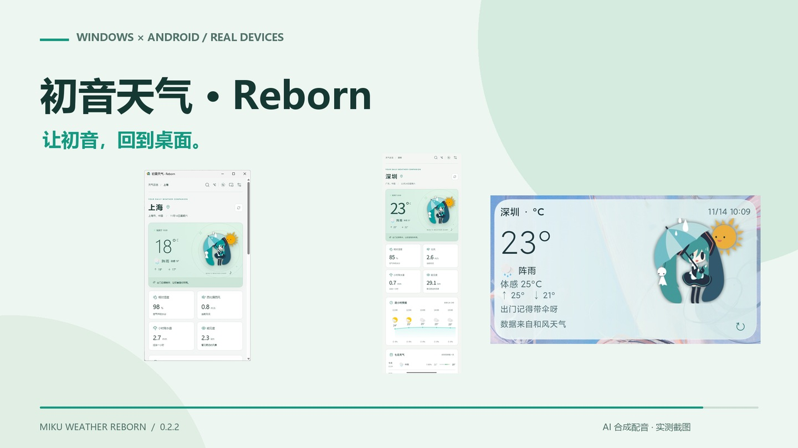
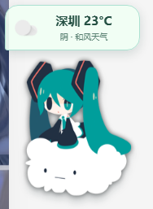
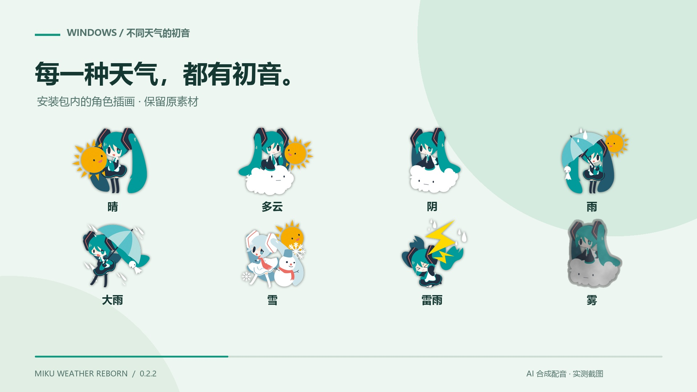
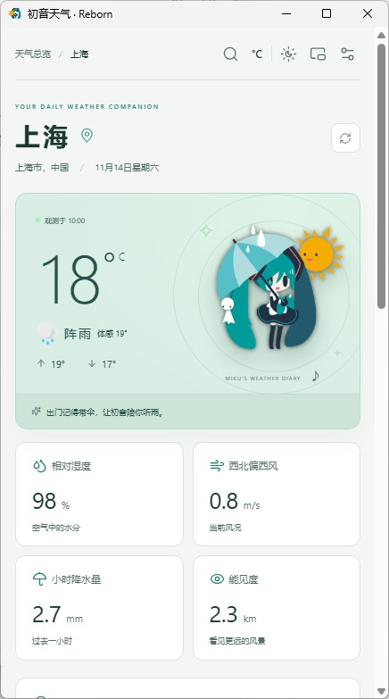
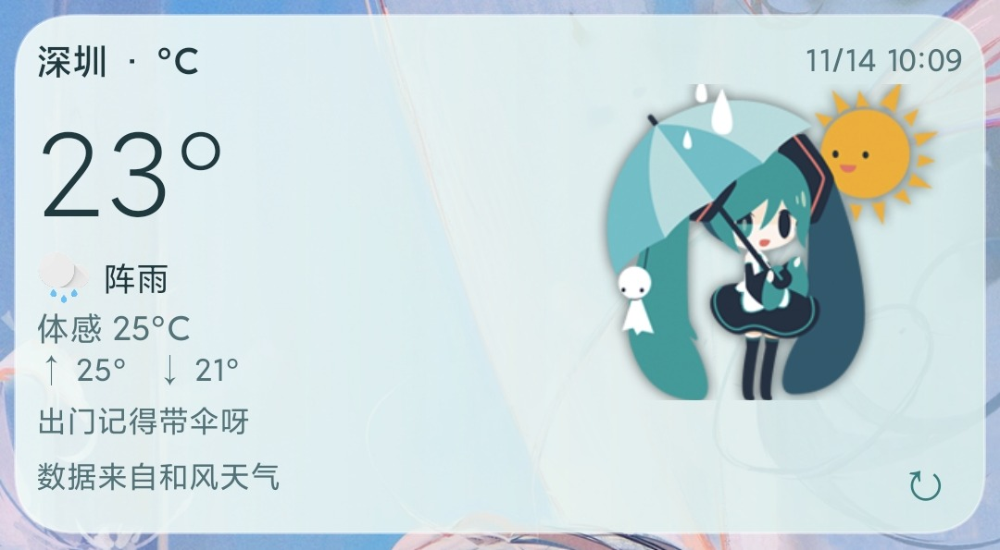

# 初音天气 · Reborn

**让初音，回到桌面。** Windows 与 Android 的非官方初音天气重制版。



重制自 [lzcapp/MikuWeather_Windows](https://github.com/lzcapp/MikuWeather_Windows)，保留随天气变化的初音插画，重做天气页面、Windows 透明桌宠和 Android 桌面小组件。天气数据来自[和风天气](https://www.qweather.com/)。当前版本 **0.2.3**。

**[下载 Windows / Android 安装包](https://github.com/dddedd51/MikuWeather-Reborn/releases/tag/v0.2.3)**。Windows 完整解压到 **`D:\MikuWeatherReborn`** 等不含中文的目录后运行。

📖 [开发日志：我用约 3636 万累计 token，重写了初音天气](docs/DEVLOG.md) · [用量统计范围](docs/token-usage.json) · [构建说明](docs/BUILD.md) · [第三方来源](THIRD_PARTY_NOTICES.md)

> 标题里的累计用量包含缓存输入，不代表新生成 token 数或实际费用。

## 可以做什么

| Windows | Android | 共享功能 |
| --- | --- | --- |
| 透明桌宠、天气气泡、拖动、右键菜单和托盘 | 天气页面、宽版与紧凑版原生桌面小组件 | 当前天气、逐小时和七日预报 |
| 腾讯 IP 定位，保留系统定位入口 | 系统 GPS / 网络定位，候选城市确认 | 城市搜索与收藏、温度单位、缓存提示 |
| 日出日落主题与插画切换 | 主题与小组件同步、手动刷新 | 浅色、深色、跟随系统与太阳主题 |

## 实测画面

### Windows：桌宠陪伴

初音常驻桌面，天气气泡显示城市、温度与天气；插画随天气变化。支持拖动位置、点击打开详情、右键菜单、置顶和托盘。



### 不同天气下的初音



以上为安装包内的角色插画，晴、多云等天气还提供昼夜版本。[提取路径与 SHA256](docs/weather-art-source.json)记录了素材来源。



### Android：天气页与桌面小组件

手机提供天气详情、城市管理与原生小组件，宽版和紧凑版卡片均保留天气、初音和刷新入口。




截图来自用户的电脑和手机，裁切与缩放用于展示。更多画面及验证范围见开发日志。

## Windows 安装：务必使用非中文目录

1. 把完整 Windows ZIP 解压到不含中文的普通目录，例如 **`D:\MikuWeatherReborn`**。
2. 在解压后的目录运行 `Miku Weather Reborn.exe`，无需管理员权限。
3. 不要在压缩包内直接运行，不要只复制 EXE；`resources` 等配套文件必须保留。

上述是本次测试采用的运行方式。开发工作区曾出现界面进程启动失败，复制完整文件到普通目录后恢复；这不是对所有中文路径的兼容性结论。

Android 8.0+：安装维护者构建的 APK，打开应用选择城市，再通过桌面“小组件”入口添加初音天气。后台更新受系统省电策略限制。

## 下载与服务状态

在 [Release v0.2.3](https://github.com/dddedd51/MikuWeather-Reborn/releases/tag/v0.2.3) 下载 Windows x64 ZIP、Android APK、源码 ZIP 和 SHA256 校验文件。源码 ZIP 不能直接当安装包运行。

**公众安装包免填 API Key；和风私钥与腾讯 Key 保存在 Cloudflare Secrets，客户端只包含公开服务网址。** 已部署 Pages 中转和 Worker，城市搜索、当前天气、七日与逐小时预报、IP 定位已通过本机直连测试。免费配额、上游服务或网络情况可能影响可用性。

源码、Git 历史以及解包后的 Windows/Android 产物均做了本项目已知凭据扫描。历史 0.2.2 自用包含凭据，不在公开 Release 分发。自建维护者见 [构建说明](docs/BUILD.md) 和 [代理部署说明](worker/README.md)。Android 使用开发签名，Windows 未做商业代码签名。

## 开发

共享界面使用 Vite / JavaScript；Windows 为 Electron，Android 为 Capacitor + Java 原生插件。保留原生小组件、缓存、请求限制及定位候选确认。

```powershell
npm ci
npm test
npm run build
```

真实天气和原生打包需要维护者服务配置，详见 [BUILD.md](docs/BUILD.md)。开发验证记录见 [开发日志](docs/DEVLOG.md)。

## 配音与来源

宣传片使用 **GPT-SoVITS 初音未来 2.0 模型的 AI 合成配音**。模型来源：**[bilibili · BV18iA2e1Eok](https://www.bilibili.com/video/BV18iA2e1Eok)**。模型权重和参考音频不随本仓库分发。

原项目采用 Anti-996 许可证，原文保留在 [LICENSE](LICENSE)。角色、插画、Pixel 天气图标和语音模型分别属于各自权利人，并不因为本仓库公开而自动适用同一许可。具体来源和使用边界见 [THIRD_PARTY_NOTICES.md](THIRD_PARTY_NOTICES.md)。

本项目为爱好者非官方重制，不代表原作者、初音未来权利人、和风天气或其他素材作者的官方产品。
