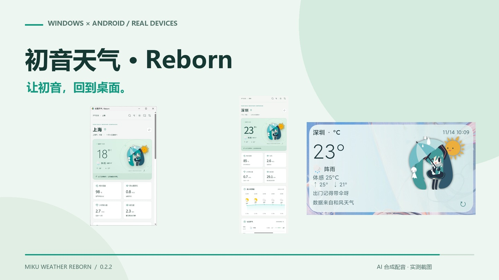
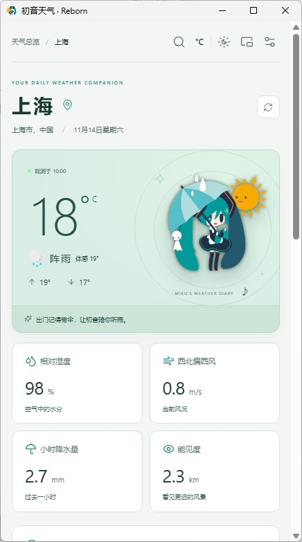
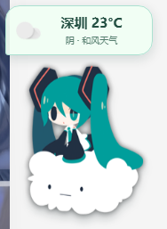
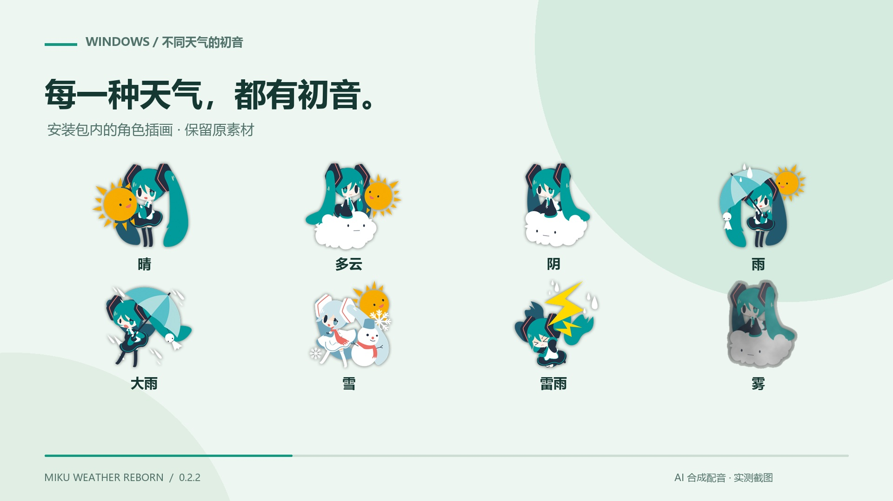
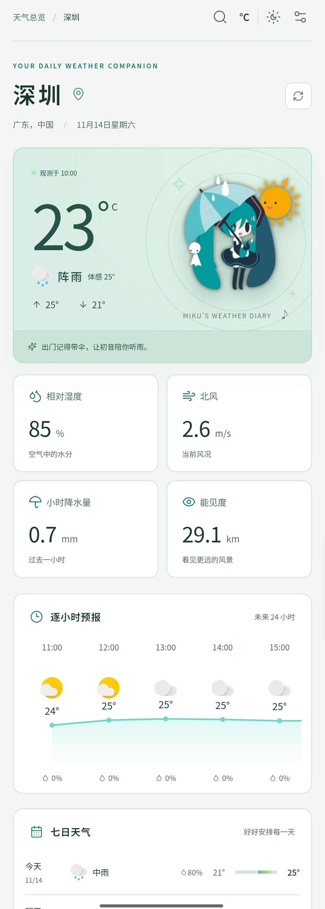
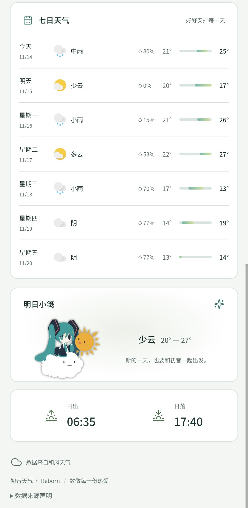
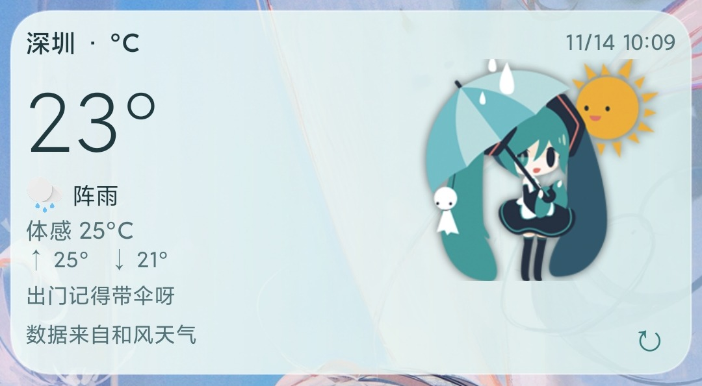

# 我用约 3636 万累计 token，重写了初音天气

> 统计包含缓存输入；不是 3636 万新生成 token，也不是费用账单。原开发主会话记录为 36,362,799 token，其中缓存输入 34,937,074。统计截止北京时间 2026 年 11 月 14 日 10:15 提交实测截图前，不含子会话与后续日志、配音、视频制作。详见文末。

我想让一个停更的天气桌宠重新回到桌面。

起点是 [lzcapp/MikuWeather_Windows](https://github.com/lzcapp/MikuWeather_Windows)。它最吸引我的地方，是会随天气变化的初音插画。旧版依赖的天气服务已经不能满足这次使用需求，于是这次不只替换接口，还做了一套 Windows 和 Android 的非官方重制版：**初音天气 · Reborn**。

这篇日志记录的是 0.2.2 的开发和实测，并补充 0.2.3 的公开分发改造。配图由我在电脑和手机上实际使用后提供；图像做了裁切和缩放，不把设计预览冒充实机画面。文中的 token 统计截止点保持不变，不包含后续代理部署和发布工作。

## 先让天气重新流动

天气数据接入和风天气，界面明确标注来源。现在可以查看当前天气、体感温度、湿度、风、能见度、逐小时与七日预报，也能搜索和收藏城市、切换摄氏与华氏。

天气软件还有一些不显眼却必要的细节：缺失数据不能显示为零；网络失败时要告诉用户正在显示缓存；重复请求需要合并，接口需要缓存。它们决定了这个工具是否能每天使用。

## Windows：初音留在桌面

Windows 版使用 Electron。默认出现的是透明桌宠与天气气泡，拖动初音可以调整位置，点击可以打开天气详情，右键可以刷新、切换城市、设置置顶或退出，也保留托盘入口。

这张桌宠特写展示深圳 23°C 的阴天：气泡在上方显示城市与天气，初音坐在云朵上。它属于 Windows 桌宠，和 Android 的桌面小组件分别实现、分别介绍。

图中的晴、多云、阴、雨、大雨、雪、雷雨和雾均来自 0.2.2 安装包；展示素材与项目对应源图做了逐个哈希核对。[素材记录](weather-art-source.json)保留了包内路径与 SHA256。它们是带初音角色的天气插画，并非页面上的 Pixel 小图标。

这部分最费时间的，不是画一个窗口，而是把透明背景、交互、定位、权限和打包后的行为串起来。曾经遇到打包程序在开发工作区中无法正常创建界面进程，同一套文件放到普通目录后却可以运行。这是本机环境中观察到的差异，不能据此认定所有中文路径都会失败。

因此安装说明采用经过这次测试的保守做法：**Windows 请把完整 ZIP 解压到不含中文的普通目录，例如 `D:\MikuWeatherReborn`，再运行 `Miku Weather Reborn.exe`。不要在压缩包内运行，也不要只拷贝 EXE。**

## Android：从天气页到桌面小组件

Android 版使用 Capacitor 和 Java 原生插件。天气详情沿用共享界面，桌面小组件则采用原生实现，提供宽版和紧凑版。一张圆角卡片里放下城市、温度、天气与初音；卡片会根据空间收起次要信息。

  
  

截图说明手机上的界面与小组件已经显示出来，但一次截图不能证明所有机型和后台状态都正常。小组件更新仍受系统省电和后台调度限制，也保留手动刷新入口。

## 定位和主题，要符合日常使用

Windows 默认提供腾讯 IP 定位，也保留系统定位入口；Android 使用系统 GPS、网络或融合位置。定位后先展示候选城市，由用户确认，避免直接把天气切到错误的地方。手机坐标只在本机匹配城市中心，不上传、不保存轨迹；IP 定位反映网络出口地区，不能保证精准。

主题默认跟随所选城市的日出日落，白天浅色，夜晚深色。天气页、桌宠和小组件同时使用这一规则。还修正了缓存中的夜间天气代码在日出后继续显示夜间插画的问题：切换昼夜不必一直等下一次天气请求。

## 验证过什么

- 开发记录中的 20 项共享 Node 测试通过，覆盖天气处理、太阳主题和 IP 定位等逻辑。
- Android 0.2.2 完成 `assembleDebug`、`testDebugUnitTest`、`lintDebug`，25 项核心测试通过，APK v2 签名验证通过。
- Windows 0.2.2 实际启动并操作了桌宠、详情和 IP 定位入口。
- 本文补充了用户提供的 Windows、Android 页面与手机桌面小组件实测截图。

Windows 备用系统定位、更多 Android 机型、长时间后台更新和极端网络情况仍需要继续验证。当前 Android 包使用开发签名，Windows 包没有商业代码签名。

## 源码公开，但密钥不能跟着公开

0.2.2 自用构建把天气凭据放在原生层，普通使用者不需要输入 API Key。但安装包可以被反编译，原生层不是保密服务器，因此这些自用包没有上传。

0.2.3 将和风私钥与腾讯 Key 放到 Cloudflare 加密 Secrets 中，客户端只保存公开服务网址。Pages 入口转给固定 Worker，服务端签发天气请求，并提供缓存和每 IP 每地点 30 次/分钟限流。两个服务之间的认证密钥也只存在 Cloudflare Secrets，不写入源码或客户端。

本机网络无法直连 workers.dev，因此补上免费的 pages.dev 入口；最终城市搜索、当前天气、七日预报、24 小时预报与腾讯 IP 定位均通过本机直接网络请求。此结果不保证所有地区或网络都可达，免费配额和上游限制仍会影响服务。

发布前通过 27 项 Node 测试、27 项 Android 测试，完成 Android lint、构建和 APK v2 签名验证。Windows ASAR、Android APK、源码 ZIP 与 Git 历史按实际持有的已知凭据扫描，检查完整私钥、编码形式及服务 Key；安装包内不包含 `private.json`。0.2.3 的在线接口和构建已验证，本文的实机截图仍来自 0.2.2；更多机型、备用系统定位与长期后台表现继续保留为待验证项。

**[下载 0.2.3 安装包](https://github.com/dddedd51/MikuWeather-Reborn/releases/tag/v0.2.3)**。另制作的宣传片将 Windows 桌宠与 Android 小组件分段介绍，展示包内初音天气插画，截图保持原始比例且不额外添加白框。配音使用文末所列初音模型，为 AI 合成声音；视频与字幕不作为 Release 附件分发。

## token 到底怎么算

以下数字直接来自原开发主会话在截止点前最后一次累计用量记录，详情保存于 [token-usage.json](token-usage.json)。没有把多次累计快照相加。

| 字段 | 记录值 |
| --- | ---: |
| 输入 token | 36,145,837 |
| 其中：缓存输入 | 34,937,074 |
| 输出 token | 216,962 |
| 其中：推理输出 | 77,276 |
| 输入与输出合计 | **36,362,799** |

缓存输入属于输入统计，推理输出属于输出统计，不再重复相加。记录还单列缓存写入 1,178,784，本文不把它另加进总量。按输入减缓存输入再加输出计算，非缓存输入与输出约为 142.6 万 token，但这也不等于实际计费 token：服务商口径、缓存写入和账单需要另行核对。本次未核实费用。

长对话会反复携带上下文，所以“累计 token”也不能理解为写出了相同数量的代码。这一数字仅描述指定主会话的记录范围。

## 致谢与素材说明

- 原项目：[lzcapp/MikuWeather_Windows](https://github.com/lzcapp/MikuWeather_Windows)，保留 Anti-996 许可证与来源。
- 天气数据：[和风天气](https://www.qweather.com/)，接口说明：[QWeather API](https://dev.qweather.com/docs/api/)。
- Windows IP 定位：[腾讯位置服务](https://lbs.qq.com/service/webService/webServiceGuide/position/webServiceIp)。
- Pixel 天气图标：Breezy Weather Pixel icon provider，作者 WangDaYeeeeee；上游将代码与图标素材许可分别说明，素材不是本项目原创。见 [第三方说明](../THIRD_PARTY_NOTICES.md)。
- 宣传片为 AI 合成配音，使用用户提供的 GPT-SoVITS 初音未来 2.0 模型。**模型来源：[BV18iA2e1Eok](https://www.bilibili.com/video/BV18iA2e1Eok)**；推理项目：[GPT-SoVITS](https://github.com/RVC-Boss/GPT-SoVITS)。不随仓库分发模型权重。

初音未来及相关插画、图标属于各自权利人。本项目是非官方爱好者重制，不代表原作者、角色权利人或天气服务商的官方产品。
